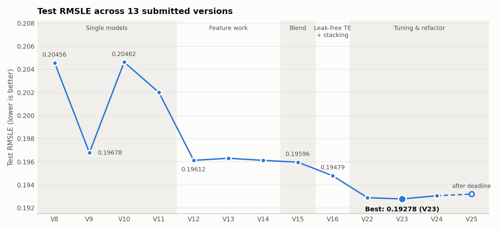
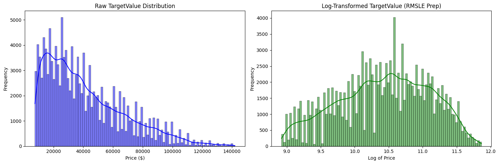
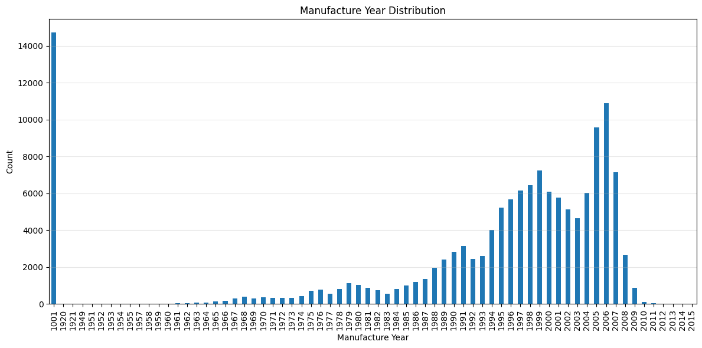
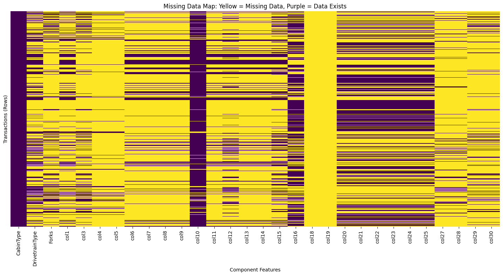
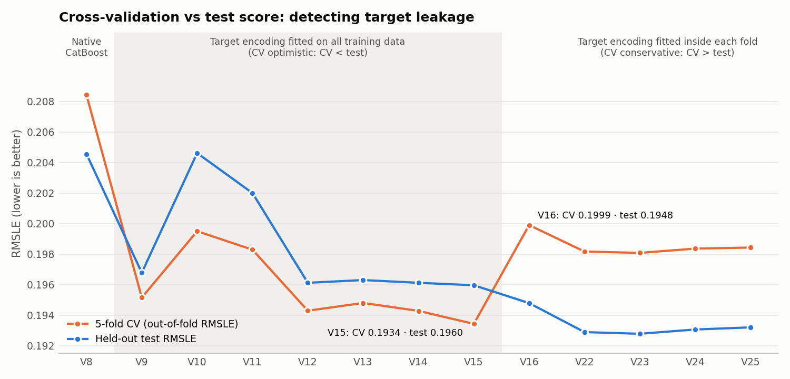

# Heavy Equipment Selling Price Prediction

**Gradient-boosted ensembles with leak-aware target encoding for pricing used industrial machinery from sparse, high-cardinality tabular data**

## Abstract

We predict the sale price of used heavy equipment (loaders, excavators, graders, tractors and more) from 50 transactional, geographic and technical attributes. The data is difficult: identifiers with thousands of categories, placeholder values posing as real years, anonymised component columns that are 75–99.95% empty, and missing values that encode *machine type* rather than lost information.

Over **13 submitted versions developed across three months** (May–July 2026), the held-out test RMSLE improved from **0.20456 to 0.19278**. The final model is a **Ridge-stacked ensemble of XGBoost, LightGBM and CatBoost**, trained on engineered features with **smoothed target encoding fitted inside each cross-validation fold**.

The main methodological finding concerns **target leakage**. Encoding categories with the target on the full training set made cross-validation look better than the test results (V9–V15). Moving the encoder inside the folds made CV *worse* but the test score *better*, and a later fully leak-free pipeline showed that the apparent gains from hyper-parameter tuning were also leakage.

| | |
|---|---|
| **Task** | Tabular regression · 138,701 training and 15,000 test transactions |
| **Metric** | Root Mean Squared Logarithmic Error (lower is better) |
| **Final model** | XGBoost + LightGBM + CatBoost → Ridge stacking (5-fold) |
| **Best test RMSLE** | **0.19278** (V23) |
| **Stacked CV RMSLE** | 0.19808 (5-fold out-of-fold) |
| **Baseline** | CatBoost with native categoricals: 0.20456 |
| **Runtime** | about 5.2 h end to end on CPU |



---

## Table of contents

1. [Problem](#1-problem)
2. [Dataset](#2-dataset)
3. [Evaluation metric](#3-evaluation-metric)
4. [Methodology](#4-methodology)
5. [Experiments](#5-experiments)
6. [Key findings](#6-key-findings)
7. [Final results](#7-final-results)
8. [Limitations and future work](#8-limitations-and-future-work)
9. [Repository structure](#9-repository-structure)
10. [Environment setup (Linux / macOS / Windows)](#10-environment-setup-linux--macos--windows)
11. [Data setup](#11-data-setup)
12. [Running the pipeline](#12-running-the-pipeline)
13. [References](#13-references)

---

## 1. Problem

Each record is a single finalised sale of a piece of heavy machinery, with system metadata, location, the machine's age and usage, a hierarchy of specification codes, and up to 27 component attributes (cab, drivetrain, tyres, hydraulics, track width, boom reach and so on). The goal is to predict the transaction value `TargetValue` in US dollars for every `TransactionID` in the test set.

Accurate price estimates for used industrial equipment support valuation, trade-in and auction pricing, and fleet financing. The problem is hard because two machines with the same model code can sell for very different prices depending on age, hours, configuration and region.

---

## 2. Dataset

| File | Rows | Columns | Description |
|---|---:|---:|---|
| `train.csv` | 138,701 | 50 | Transactions with the target `TargetValue` |
| `test.csv` | 15,000 | 49 | Transactions to predict |
| `metadata.csv` | 50 | 2 | A plain-language description of every column |
| `sample_submission.csv` | 15,000 | 2 | `TransactionID, TargetValue` |

### Feature groups

| Group | Columns | Notes |
|---|---|---|
| Identifiers | `TransactionID`, `AssetID`, `ProductConfigID` | `AssetID` has 120,111 values (nearly unique); `ProductConfigID` has 3,594 |
| Source and partner | `DataOriginCode`, `VendorPartnerID` | 6 and 31 values |
| Time | `TransactionDate`, `ManufactureYear` | Sales span 24 years |
| Usage | `OperationalHoursMeter`, `UtilizationTier` | 40.8% and 63.6% missing |
| Specification hierarchy | `Spec_FullDescriptor` → `Spec_BaseClass`, `Spec_SubClass`, `Spec_ReleaseSeries`, `Spec_VariantModifier` | 3,505 / 1,249 / 147 / 113 / 132 values |
| Classification | `FunctionalClassification`, `InventoryGroupCategory` / `Description`, `AssetScaleFactor` | e.g. *"Wheel Loader - 150.0 to 175.0 Horsepower"* |
| Location | `RegionCode` | 53 regions |
| Components | `CabinType`, `DrivetrainType`, `Forks`, `col1`–`col30` | Anonymised; `metadata.csv` describes each (e.g. `col15` = tyre size, `col22` = arm reach) |

### Data challenges

**1. Skewed target.** Prices range from \$7,500 to \$142,000 (median \$35,000, mean \$41,522), with a long right tail. `TargetValue` takes only 675 distinct values, which suggests rounded sale prices.



**2. Placeholder years.** 14,719 rows (10.6%) have `ManufactureYear = 1001`, a code for *unknown*, not a real year. Used as-is, it would produce asset ages of about 1,000 years.



**3. Structured missingness.** Component columns are not randomly missing. Each block exists for exactly one inventory group:

| Inventory group | Rows | Component columns present |
|---|---:|---|
| TEX | 71,018 | `col20`–`col25` |
| MG | 23,405 | `col6`–`col9`, `col11`, `col13`, `col14` |
| WL (Wheel Loader) | 18,872 | `col29`, `col30` |
| TTT | 14,959 | `col27`, `col28` |
| BL | 10,381 | `col4`, `col5` (the only group missing `col10`) |
| SSL | 66 | `col18`, `col19` |



A missing component therefore usually means *not applicable to this machine type*, which is itself informative. Dropping the sparse columns (V13) made results worse.

**4. High cardinality and noisy strings.** Specification codes have thousands of levels. Measurements are stored as text (`12' 4"`, `23.5"`, `28 inch`), and the hour meter contains extreme values (up to 1,729,600 hours).

---

## 3. Evaluation metric

```math
\text{RMSLE} = \sqrt{\frac{1}{n}\sum_{i=1}^{n}\big(\log(1+\hat{y}_i) - \log(1+y_i)\big)^2}
```

RMSLE penalises **relative** error, so a \$5,000 miss on a \$20,000 machine counts more than on a \$120,000 one. Because RMSLE is the RMSE of $\log(1+y)$, every model is trained with a squared-error objective on `log1p(TargetValue)`. Predictions are mapped back with `expm1` and clipped at 0.

---

## 4. Methodology

```text
train.csv / test.csv
      │
      ▼
Parse FunctionalClassification ─► family, drive type, capacity range, unit
Parse measurement strings       ─► feet / inches as numbers
Feature engineering             ─► date parts, asset age, missing flags, fills
DataTransformer                 ─► median imputation, hours log, hours per year, ordinal encoding
      │
      ▼
5-fold CV ── per fold ───────────────────────────────────────────────┐
  Smoothed target encoding (fitted on training fold only)             │
  XGBoost  (ordinal + target-encoded features)                        │
  LightGBM (ordinal + target-encoded features)                        │
  CatBoost (ordinal features)                                         │
      │                                                               │
      ▼                                                               │
Out-of-fold predictions ─► Ridge meta-model (5-fold) ─► test predictions
```

### 4.1 Feature engineering

| Feature | Construction | Rationale |
|---|---|---|
| `TransactionYear`, `Month`, `Quarter`, `Day`, `DayOfWeek` | From `TransactionDate` | Market level and seasonality |
| `AssetAge` | `TransactionYear − ManufactureYear` (negative → `NaN`) | Depreciation is the main price driver |
| `ManufactureYearMissing` | Year ∈ {1000, 1001} → flag, value → `NaN` | Separates *unknown* from *old* |
| `HoursMissing`, `OperationalHoursLog` | Missing flag; `log1p(hours)` after median imputation | Tames extreme hour-meter values |
| `HoursPerYear` | `hours / (AssetAge + 1)` | Usage intensity, independent of age |
| `FC_MachineFamily`, `FC_DriveType` | Parsed from `FunctionalClassification` | Shared structure across model codes |
| `FC_LowerBound`, `FC_UpperBound`, `FC_Unit`, `FC_IsPlusRange`, `FC_RangeKnown` | Parsed capacity range such as *150.0 to 175.0 Horsepower* | Turns a label into an ordered size signal |
| `col7_Numeric_Feet`, `col15_Numeric_Inches`, `col21_Numeric_Inches`, `col22_Total_Inches` | Parsed measurement strings | Makes physical size usable by trees |
| `Missing_BaseClass` | Missing flag | Missingness indicator |
| Fills | `"Unknown"` for 7 sparse descriptive columns; `"Not Applicable"` for component columns | Keeps structured missingness as a category |

Dropped: `TransactionID`, `AssetID` (near-unique), `InventoryGroupCategory` (duplicated by its description column), and `col18`/`col19` (99.95% missing).

### 4.2 Encoding

- **Ordinal encoding** of all categorical columns (unseen categories become −1).
- **Smoothed target encoding** for the 8 categorical columns with more than 20 levels (`VendorPartnerID`, the four `Spec_*` columns, `Spec_FullDescriptor`, `FunctionalClassification`, `RegionCode`), computed on the log-target:

```math
\text{TE}(c) = \frac{n_c\,\bar{y}_c + \alpha\,\bar{y}}{n_c + \alpha}, \qquad \alpha = 15
```

Rare categories shrink toward the global mean $\bar{y}$, and unseen categories receive $\bar{y}$. **The encoder is fitted inside each training fold** and applied to the validation fold and the test set. XGBoost and LightGBM receive the encoded features; CatBoost receives the ordinal features only.

### 4.3 Models

| Model | Baseline configuration | Final configuration |
|---|---|---|
| **XGBoost** | 12,000 trees, lr 0.018, depth 8, min child weight 5, subsample and colsample 0.85, λ 3, α 0.1, `hist` | Tuned: depth 9, lr 0.018, min child weight 4, subsample 0.82, colsample 0.88, λ 2.5, α 0.15 |
| **LightGBM** | 12,000 trees, lr 0.018, 80 leaves, min child samples 30, subsample and colsample 0.85, λ 3 | Tuned: 88 leaves, lr 0.02, min child samples 25, subsample 0.83, colsample 0.83, λ 3.0 |
| **CatBoost** | 12,000 iterations, lr 0.018, depth 8, L2 5 | Baseline kept (tuning did not improve it) |

All three use early stopping (300 rounds) on the validation fold. Tuning is a `RandomizedSearchCV` over 5 configurations per model from narrow grids around the baseline.

### 4.4 Validation and stacking

- **5-fold shuffled `KFold`** (seed 42), producing out-of-fold (OOF) predictions for every training row and 5-fold-averaged test predictions.
- **Ridge regression** (α = 1) as the meta-model on the three models' OOF log-predictions, evaluated with its own 5-fold CV and then refitted on all OOF predictions.

---

## 5. Experiments

Thirteen versions were submitted. Scores are RMSLE (lower is better). CV is the 5-fold out-of-fold score, and test is the held-out evaluation set.

| Version | Change | CV | Test |
|---|---|---:|---:|
| **V8** | Baseline: CatBoost with native handling of 42 categorical columns (5,000 iterations, about 58 min per fold) | 0.20843 | 0.20456 |
| **V9** | XGBoost (3,000 trees, depth 8) + ordinal encoding + target encoding of 8 high-cardinality columns | 0.19515 | 0.19678 |
| **V10** | CatBoost on the same encoded features | 0.19950 | 0.20462 |
| **V11** | LightGBM on the same encoded features | 0.19829 | 0.20200 |
| **V12** | XGBoost + `TransactionDay`, `DayOfWeek`, `HoursPerYear`, `Missing_BaseClass` | 0.19429 | 0.19612 |
| **V13** | V12 minus the 15 columns with >80% missing | 0.19480 | 0.19630 |
| **V14** | Re-run of V12 (reproducibility check: identical scores) | 0.19428 | 0.19612 |
| **V15** | XGBoost + LightGBM + CatBoost (6,000 trees, lr 0.02), OOF-weighted blend 0.65 / 0.30 / 0.05; year 1000 also treated as missing; median hour imputation | 0.19343 | 0.19596 |
| **V16** | **Target encoding moved inside the folds** (smoothed, α = 15); `FunctionalClassification` and measurement parsing; **Ridge stacking**; EDA | 0.19990 | 0.19479 |
| **V22** | Refactor into `feature_engineering()` and `DataTransformer`; 12,000 trees; α = 20; randomized tuning | 0.19817 | 0.19289 |
| **V23** | **α = 15, learning rate 0.018** | **0.19808** | **0.19278** |
| **V24** | α = 10, 3 tuning iterations | 0.19836 | 0.19306 |
| **V25** | Fully leak-free scikit-learn `Pipeline` (preprocessing fitted in every fold, including during tuning); submitted after the deadline | 0.19843 | 0.19320 |

Milestone notebooks V8, V15, V16 and V25 are kept in [`versions/`](versions/).

---

## 6. Key findings

### 6.1 Target leakage made cross-validation lie



In V9–V15 the target encoder was fitted on the **entire** training set before cross-validation. Every validation row had already contributed to its own category's encoding, so CV was consistently **better** than the test score (V15: CV 0.1934 vs test 0.1960).

V16 fitted the encoder **inside each training fold**. CV became *worse* (0.1999) while the test score became *better* (0.1948), and CV became a conservative estimate from then on. This was the most important change in the project. It made CV trustworthy for model selection, and every later improvement built on it.

### 6.2 The apparent tuning gains were also leakage

In V22–V24 the tuning function fitted the target encoder on all training data before `RandomizedSearchCV`. The search reported large gains (XGBoost 0.2017 → 0.1970), but retraining with in-fold encoding gave almost none (XGBoost 0.20168 → 0.20173; LightGBM 0.20245 → 0.20178). V25 wrapped preprocessing, encoding and model in one `Pipeline`, and the tuning then found **no improvement** (XGBoost 0.20162 → 0.20165). The later gains came from features, stacking and the encoding set-up, not from tuning.

### 6.3 Smoothing strength matters, a little

| α (target-encoding smoothing) | Test RMSLE |
|---:|---:|
| 20 (V22) | 0.19289 |
| **15 (V23)** | **0.19278** |
| 10 (V24) | 0.19306 |

A moderate prior was best. These runs also differed slightly in learning rate (V22 → V23) and tuning iterations (V23 → V24), so this is indicative rather than a clean ablation.

### 6.4 Other lessons

- **Missingness is signal.** Dropping the >80%-missing columns (V13) was worse than keeping them as `"Not Applicable"`, consistent with the structured missingness in Section 2.
- **Model diversity pays off.** XGBoost and LightGBM are nearly tied individually (0.2017 / 0.2018 CV), while CatBoost is weaker (0.2075). The Ridge stack still gains about 0.0037 over the best single model.
- **Native categorical handling was slow and weaker here.** CatBoost with 42 raw categorical features took about an hour per fold and scored 0.2046, worse than explicit encodings with XGBoost (0.1968).
- **Reproducibility checked.** V14 reproduced V12 exactly (CV 0.19428 vs 0.19429, identical test score).

---

## 7. Final results

| Model (V23) | 5-fold CV RMSLE |
|---|---:|
| XGBoost | 0.20173 |
| LightGBM | 0.20178 |
| CatBoost | 0.20749 |
| **Ridge stack** | **0.19808** |
| **Held-out test** | **0.19278** |

Improvement over the baseline: **0.20456 → 0.19278 (−5.8% RMSLE)**.

---

## 8. Limitations and future work

- **Leak-free tuning at scale.** V25's pipeline is the correct approach. A larger search (Optuna, more iterations) in that setting is the natural next step.
- **Tree budget.** LightGBM used 11,654–12,000 of its 12,000 trees in every fold, so it had not converged. A higher learning rate or a larger budget may help.
- **Time-aware validation.** Shuffled K-fold mixes years. Validating on later sale dates would better match how a pricing model is used.
- **Repeat-sale and model-level features.** Prior sale prices of the same `ProductConfigID` or model code, computed within folds, could capture market value directly.
- **Minor preprocessing leakage.** In V23 the median imputer and ordinal encoder are fitted on the full training set before CV. The effect is small, but V25 removes it.
- **Native categorical models on GPU.** CatBoost with `cat_features` was accurate but slow on CPU; GPU training would make it practical to include in the stack.

---

## 9. Repository structure

```text
heavy_equipment_price_prediction/
├── README.md
├── LICENSE
├── requirements.txt
├── .gitignore
├── assets/                                   # figures used in this README
│   ├── experiment_progression.png
│   ├── cv_vs_test.png
│   ├── target_distribution.png
│   ├── manufacture_year_distribution.png
│   └── missing_data_map.png
├── notebook/
│   └── heavy_equipment_price_prediction.ipynb   # final pipeline (V23), annotated, with outputs
├── versions/                                 # milestone notebooks (original Kaggle runs)
│   ├── README.md
│   ├── v08_catboost_native_categoricals.ipynb
│   ├── v15_three_model_blend.ipynb
│   ├── v16_leakfree_target_encoding_stacking.ipynb
│   └── v25_leakfree_pipeline_tuning.ipynb
```

The datasets (`*.csv`) and the virtual environment are excluded from Git by `.gitignore`.

---

## 10. Environment setup (Linux / macOS / Windows)

### Prerequisites

- **Python 3.14** (tested with 3.14.7; the Kaggle runs used Python 3.12)
- **Git**
- A multi-core CPU. Training is CPU-only, and no GPU is needed.
- **macOS only:** XGBoost and LightGBM need the OpenMP runtime:

  ```bash
  brew install libomp
  ```

### 1. Clone the repository

```bash
git clone https://github.com/vp916/heavy_equipment_price_prediction.git
cd heavy_equipment_price_prediction
```

### 2. Create a virtual environment

**Linux / macOS**

```bash
python3 -m venv .venv
```

**Windows**

```powershell
py -3.14 -m venv .venv
```

### 3. Activate it

| Platform / shell | Command |
|---|---|
| Linux / macOS (bash, zsh) | `source .venv/bin/activate` |
| Linux / macOS (fish) | `source .venv/bin/activate.fish` |
| Windows (PowerShell) | `.venv\Scripts\Activate.ps1` |
| Windows (Command Prompt) | `.venv\Scripts\activate.bat` |

> **Windows PowerShell:** if activation is blocked, allow local scripts once with
> `Set-ExecutionPolicy -Scope CurrentUser RemoteSigned`.

### 4. Install dependencies

```bash
python -m pip install --upgrade pip
python -m pip install -r requirements.txt
```

`requirements.txt` pins exact versions for reproducibility. The Linux-only `nvidia-nccl-cu13` dependency of XGBoost is restricted to Linux with an environment marker, so the same file installs on Windows and macOS.

### 5. Register the Jupyter kernel

```bash
python -m ipykernel install --user --name heavy-equipment --display-name "Heavy Equipment (Python 3.14)"
```

Select **Heavy Equipment (Python 3.14)** as the kernel in VS Code or Jupyter.

### 6. Verify

```bash
python -c "import sys, xgboost, lightgbm, catboost, sklearn; print(sys.executable); print('xgboost', xgboost.__version__, '| lightgbm', lightgbm.__version__, '| catboost', catboost.__version__, '| sklearn', sklearn.__version__)"
```

`sys.executable` should point inside `.venv` (`.venv/bin/python` on Linux/macOS, `.venv\Scripts\python.exe` on Windows).

---

## 11. Data setup

The dataset is not included in this repository. Download `train.csv`, `test.csv`, `metadata.csv` and `sample_submission.csv` from the Kaggle page for **Heavy Equipment Selling Price Prediction Challenge**, and place them in the **project root**, which is where the notebook looks by default (`DATA_DIR = ".."` relative to `notebook/`).

With the Kaggle CLI (requires an API token in `~/.kaggle/kaggle.json`, or `%USERPROFILE%\.kaggle\kaggle.json` on Windows):

```bash
python -m pip install kaggle
kaggle competitions download -c heavy-equipment-selling-price-prediction-challenge
```

Then unzip the downloaded archive into the project root:

```bash
# Linux / macOS
unzip heavy-equipment-selling-price-prediction-challenge.zip -d .
```

```powershell
# Windows (PowerShell)
Expand-Archive heavy-equipment-selling-price-prediction-challenge.zip -DestinationPath .
```

```text
heavy_equipment_price_prediction/
├── train.csv
├── test.csv
├── metadata.csv
├── sample_submission.csv
└── notebook/ ...
```

---

## 12. Running the pipeline

```bash
# with the virtual environment activated
jupyter lab notebook/heavy_equipment_price_prediction.ipynb
```

or open the notebook in VS Code and choose the **Heavy Equipment (Python 3.14)** kernel. Then run all cells.

| Stage | Approximate time (CPU) |
|---|---:|
| EDA and feature engineering | < 1 min |
| Baseline 5-fold training (3 models) | about 1.0 h |
| Hyper-parameter search | about 3.0 h |
| Retraining with tuned parameters | about 1.1 h |
| Stacking and submission | < 1 min |

The notebook writes `submission.csv` (15,000 rows: `TransactionID, TargetValue`). To skip tuning, run the training cells once and go straight to the stacking section; this took about 1 h in our runs.

---

## 13. References

1. Chen, T., & Guestrin, C. (2016). *XGBoost: A Scalable Tree Boosting System.* KDD.
2. Ke, G., Meng, Q., Finley, T., Wang, T., Chen, W., Ma, W., Ye, Q., & Liu, T.-Y. (2017). *LightGBM: A Highly Efficient Gradient Boosting Decision Tree.* NeurIPS.
3. Prokhorenkova, L., Gusev, G., Vorobev, A., Dorogush, A. V., & Gulin, A. (2018). *CatBoost: Unbiased Boosting with Categorical Features.* NeurIPS.
4. Wolpert, D. H. (1992). *Stacked Generalization.* Neural Networks, 5(2).
5. Micci-Barreca, D. (2001). *A Preprocessing Scheme for High-Cardinality Categorical Attributes in Classification and Prediction Problems.* ACM SIGKDD Explorations, 3(1).
6. Pedregosa, F., et al. (2011). *Scikit-learn: Machine Learning in Python.* JMLR, 12.

---

## License

The code in this repository is released under the [MIT License](LICENSE).
The dataset belongs to the Kaggle competition host. It is **not** included in this repository or covered by this license; see the competition rules for the data terms.
